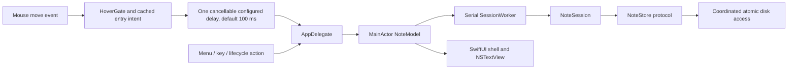
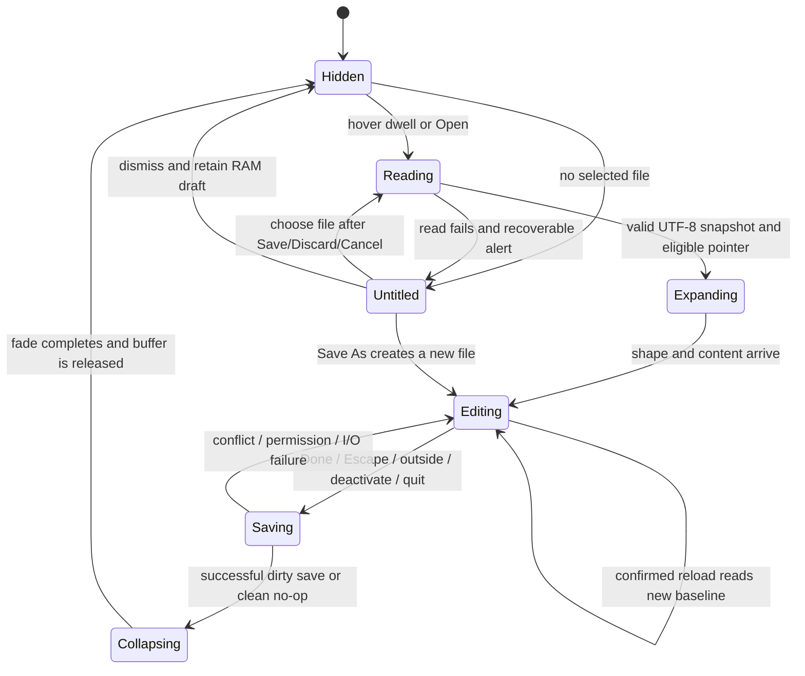

# Architecture

## Boundaries

| Component | Responsibility | Must not do |
| --- | --- | --- |
| `NotchGeometry`, `HoverGate`, `HoverDelay`, `NotchMotion`, `NotchContour`, `AnimationSpeed` | Pure attached geometry, spring samples, contour and hover policy | Touch windows, disk, or preferences |
| `NoteStore` / `DiskNoteStore` | Bounded UTF-8 reads, coordinated compare-and-atomic-replace | Own UI or discard buffers |
| `NoteSession` | Baseline bytes, editable text, open/save/close/reload transitions | Hide editor after failed save |
| `SessionWorker` | Serial ownership of synchronous session and disk transactions | Access UI state |
| `NoteModel` | Main-actor observable state, I/O busy gating, error presentation | Do file I/O synchronously on main actor |
| `NativeEditor`, `NoteTextView`, `NoteView`, `NoteFooter` | Stable native editing, preview, collapsible bottom controls and lightweight footer identity | Convert formatted text back to source |
| `NotchPresenter` | Fixed-window silhouette animation and content arrival/departure | Save files, clear unsaved buffers, use private filters |
| `AppSettings` | Production preferences or RAM-only isolated-test settings | Write production preferences from GUI smoke |
| `SettingsPopupView`, `SettingsPopupState` | Transient settings UI and current system-preference snapshot | Register login, persist settings, or replace the native editor directly |
| `AppDelegate` | Panels, menu commands, mouse events, dialogs, bookmarks, login lifecycle | Bypass model save before hiding/quit |

## Lifecycle and loss prevention

1. File-backed notes require a successful `NoteSession.close()` before hiding or
   normal termination. Untitled drafts hide without disk I/O and remain in RAM;
   replacing them or quitting requires Save/Discard/Cancel when nonempty.
2. Failed writes retain URL, baseline, current text, dirty flag, and open state.
3. A failed reload retains all existing edits. Read first, mutate second.
4. Opening an already-open session is a no-op; choosing another file closes first.
5. Bytes, not size or mtime, determine a save conflict. No edited content is
   written when the baseline has changed.
6. A clean close does not need to write, even if the file changed externally.
7. Each open after close asks the store for a snapshot. Production uses
   `WatchedNoteStore`: one bounded RAM snapshot plus native observation and
   conservative worker-side metadata validation. See File observation below.
8. Security-scoped access starts before file read and remains active while
   hidden for observation, until a successful file switch or termination.
9. Save/reload/open operations are serialized and UI controls are disabled during
   them. Normal quit is asynchronous (`terminateLater`) and is acknowledged only
   after successful save. A request during an existing I/O transaction is refused;
   retry once it finishes.
10. The worker releases saved source/baseline on close. The UI retains its
    outgoing presentation until collapse ends, with editing disabled, then clears it.
11. Neither canceling a file picker nor a failed read creates/truncates the target.
12. One RAM-only selection range survives source release for the last file.
    Successful open/reload clamps it to the fresh source; a successful file
    switch resets it. An open/reload revision requests restoration independently
    of source-byte changes. Native selection checkpoints do not publish view
    invalidations. See `NATIVE-EDITOR.md` for Unicode, composition and focus policy.
13. An independent clip-view origin survives only when freshly read source matches
    the last displayed/saved source fingerprint. The file worker computes SHA-256;
    the session/UI contents are released, while the store may retain its one cache snapshot. Native layout restores/constrains the
    viewport once, and focus must not force an intentionally offscreen caret into view.

## Reusable presentation boundary

The presenter accepts a platform `NSPanel` and arbitrary `NSView`. The caller
supplies window/focus policy and may embed AppKit content directly or SwiftUI
through an NSHostingView. The presenter knows no NoteModel, editor, selected
file, bookmark or save policy. It stays a cohesive component in this module;
there is no speculative plug-in protocol or separate framework.

One cancellable task tracks the active transition. Replacement/configuration
invalidates the generation and cancels that task; natural completion and
cancellation settle phase/visibility through one method. The presenter's
reveal/dismiss implementations do not mutate state after their transition await. This prevents a resumed
old reveal from marking a replacement complete or an old close from hiding it.

Multiple callers can await the task without a hand-maintained continuation list.
`waitUntilSettled` rechecks for a replacement after each awaited task completes.
The visual spring sampler, contour, content transform/fade and speed clock are
unchanged: reducing animation fidelity was not justified by this refactor.

## Hover and display coordinates

All coordinates use AppKit global points, including negative display origins.
`NSScreen.safeAreaInsets.top` measures camera height; auxiliary top-left/right
regions provide camera width. The trigger includes the camera strip and six
points below it. Non-notched screens use a top-center 120 by 8 point strip.
The black surface attaches to the top edge. A camera-safe content inset leaves at
least 24 points plus 8 points above the editor. The native window reserves the
expanded size plus overshoot once; a Core Animation path mask grows from the notch
inside it. It uses status-bar level so the attached shoulders are not hidden under
the menu bar. See `NOTCH-UX.md` for the motion/focus/hover contract.

Both local and global mouse monitors are needed: global monitors do not deliver
the app's own events. Neither consumes mouse clicks. A local keyboard monitor
handles Escape only. When closed, reentry is suppressed until the pointer leaves
the trigger. A dwell callback rechecks both display availability and pointer
position; a hover read rechecks eligibility again before showing; screen reconfiguration cancels pending dwell.

Dialogs and the transient settings popup inhibit automatic close. The optional left-wing indicator uses the same contour and ignores mouse events;
the same mouse monitor includes its contour in the hover target. It is removed
when the editor opens. No NSStatusItem is allocated. Reopening the running app
through Finder/Spotlight reveals the surface as a non-hover alternative. The
expanded gear and collapsed chevron are native accessible buttons;
Command-comma uses the normal application menu.
Display-change notifications reconstruct indicators and reposition a visible
editor without touching the current text.

Hover-close retention is intentionally separate from the exact contour used by
outside-click handling. An open surface has a display-clamped 48-point horizontal
and 24-point bottom grace region. The native window, closed trigger and visible
mask are unchanged; outside clicks in that region still intentionally close.
The existing 180 ms delayed close and modal/pin/drag/save protections are unchanged.

## Persistence and transaction limits

UTF-8 files are limited to 64 MiB. The reader checks size and then reads at most
limit plus one byte to guard file growth between stat and read. All file-store
operations run on the worker queue at user-initiated QoS, allowing the UI to show
a progress overlay while cloud/file-provider coordination waits. There is no
force-cancel facility for a stalled file provider; do not force quit with valuable
unsaved edits. Size-bounded synchronous core operations are independently tested.

`NSFileCoordinator` reads the current bytes and atomically replaces the destination
within its coordinated write. This reduces races with cooperating apps but is
not compare-and-swap against arbitrary processes. Atomic replacement can change
file identity and metadata; this is a text-file editor, not an inode-preserving
filesystem transaction engine. No journal is written in the background.

## Explicit non-goals

Multiple notes/tabs, full Markdown semantics, WYSIWYG, cloud sync, automatic
merging, background autosave, a global keyboard shortcut, document history,
App Store sandbox distribution, and Windows/Linux support are out of scope.

## Information section and settings popup

Disclosure state belongs to `NoteModel` and resets on each successful file open.
Only the information/control section is a conditional SwiftUI subview: the editor remains at the
same structural position, retaining selection/undo when its viewport resizes.
Error recovery stays outside the disclosure. Cmd-Return is registered in the
native File menu rather than depending on the visibility of the Done button.

`NoteFooter` is always present below the information section, independent of
editing/preview/welcome content. It overlays the cached 14-point frog and a small
Scribbit label at left. Eight points of padding above the 20-point row separate
it from the editor/preview, reserving 28 points overall without changing
the centered full-width native disclosure. The brand is not interactive, so it
does not acquire editor focus or replace the settings anchor. The optional
resting-wing preference continues to affect only the closed surface.

The expanded-section gear anchors one native transient `NSPopover`, whose
SwiftUI content observes the note model and a small `SettingsPopupState` snapshot.
The controller alone owns persistence, file actions, Service Management, and
presentation. The section also contains filename, selectable full path, and
pin/preview icon buttons; those editing modes are not preference checkboxes.
Their selected fill/tint and accessible On/Off state show the current mode.
Command-comma can use the always-visible native chevron as a fallback anchor when
collapsed, so it needs neither a hidden gear nor asynchronous layout retry.
The controller refreshes indicator/login state when the popup opens and after
changes. `NSApp.mainMenu` remains for standard editing/keyboard actions; it is not
a persistent system menu-bar status item.

Popup presentation holds pointer-exit, outside-click and app-deactivation close.
Escape dismisses the popup before closing the note. Explicit Done/Choose/Create/
Quit paths dismiss it before continuing their normal save-first lifecycle.
When no file has been selected, the same native editor presents an editable
untitled notepad. A permanently visible strip offers Open and Save As, and warns
that unsaved changes will be lost on quit. `NoteModel.isUntitled` distinguishes
this RAM-only mode from a file-worker session. Closing the surface retains its
source, caret and viewport until reopening, explicit discard or process exit.
There is no autosave database or recovery journal. File-backed hidden buffers
continue to be released as before.

Open and normal quit accept pending native composition, then ask Save As / Cancel /
Discard for a nonempty draft, including when it was hidden. Cancelling preserves
it. Save As uses a native sheet, creates a new UTF-8 file without overwriting,
checks the 64 MiB source bound, opens it through the serial worker and verifies
its bytes still match the draft before adopting the file-backed session. Failure
leaves the draft editable; if a file was created before a failed read-back, the
error instructs the user to choose a new path. Subsequent file saves retain the
original coordinated exact-byte conflict protection. No third-party dependency
or additional disk polling is introduced.

### About sheet ordering and camera safety

The notch panel is deliberately status-bar-level. The previous About path used
an unparented `NSAlert.runModal`, whose normal/modal-panel ordering can fall below
that elevated surface and has no camera-safe attachment point. About now uses
`beginSheetModal(for:)`, explicitly at its parent panel's level. Native sheet
parenting keeps the dialog ordered with the note rather than behind it.
The alert content is minimal: native application icon, display name and version
from the packaged bundle, Close, and a secondary Reset App action. It contains no usage/help dump or custom
screen-position offsets. The existing camera-safe attachment is unchanged.

The panel's `NSWindowDelegate` sheet-position callback delegates to
`NotchGeometry.sheetAttachmentRect`. It maps the same screen/content-top boundary
used by the note into current window coordinates, preserving a lower native
attachment when supplied. It does not assume a primary display, positive screen
origin, fixed camera height, or fixed screen point. Selectable path/error text
is never mistaken for the editable note when restoring first responder.

`AppSettings.animationSpeed` is normalized on both read/write. One controller
method synchronizes settings, observed model, presenter, and popup slider.
The presenter snapshots the playback rate for the whole transition. The shape's
sample values/key times are unchanged; its duration, content effects, and final
completion delay are scaled together. Reduce Motion remains a fixed 140 ms fade.

The resting window and animated host share `NotchContour` and `NotchGeometry`'s
left-wing frame. The shape's horizontal offset follows the width spring from the
wing's center to the camera center and back; the native panel does not move on
animation frames. `NativeSnapshot` applies the shared contour to GUI-test images.

## Native editor and indentation commands

The editor uses no third-party runtime packages or engine selector. File bookmarks,
speed and indicator preferences belong to the app's own settings domain.
macOS 14 is the minimum.

`NoteTextView` subclasses NSTextView solely to implement `insertBacktab:`. The
pure `TextIndentation.outdent` plan uses UTF-16 offsets, preserves separators and
Unicode, and excludes the following line when a selection ends at column zero.
The command uses the public range-edit permission API, one text-storage
replacement, a scoped undo group and `didChangeText`. It respects editability,
live composition, multiple selections and delegate vetoes. No custom undo engine,
composition implementation, keyboard event monitor or text reset is involved.
AppKit retains ordinary Tab, selection, clipboard, find and input-method behavior.

The SwiftUI coordinator tracks the last model source using exact UTF-8 bytes so
chrome-only updates do not replace AppKit's live preedit buffer. Only genuine
model replacements assign the editor string, clamp selection and clear history.
Save/Close accept pending composition through AppKit's public `unmarkText` before
persisting. See `NATIVE-EDITOR.md` for contract details and test limitations.

## First-time setup reset

About contains the secondary Reset App action, not the normal settings controls.
A camera-safe native confirmation sheet describes exactly what will be reset.
A separate Save or Save As / Cancel / Discard sheet resolves dirty file/draft
text first. Cancelling either sheet or failing to save leaves the session intact.
Discard is deferred until Launch at Login can be disabled; if unregistering fails,
reset aborts rather than clearing the note/preferences. Native editing stays
disabled during asynchronous login removal so later keystrokes cannot slip past
the earlier Save/Discard decision. A user-selected Save may
have already saved the note at that point, but no automatic deletion or truncation
is part of reset.

| Layer | Reset behavior |
| --- | --- |
| NoteSession | Explicit confirmed discard clears URL/source/baseline and the store snapshot, cancels observations, with no disk read/write |
| NoteModel | Clears note identity, dirty source, errors, selection, viewport and fingerprint; opens blank untitled mode |
| AppSettings | Removes only noteBookmark, didOfferLogin, showNotchIndicator, animationSpeed and hoverDelay; never removes the defaults domain |
| Controller | Releases scoped access, cancels pending hover tasks, resets hover/pin/preview state, restores animation/hover defaults and clears native undo history |
| Login | Production explicitly unregisters an enabled/pending login item; isolated mode never calls ServiceManagement |
| Presentation | Returns to focused editable blank notepad immediately, without restart |

The first-launch login marker is reset too. Login is disabled immediately; like a
fresh installation, the next actual app launch attempts automatic registration
again. The reset confirmation states this explicitly. There is no user-note file
delete operation, hidden database or external reset command.

## File observation and hidden snapshot cache

Production constructs NoteSession with WatchedNoteStore wrapping DiskNoteStore.
NoteSession remains UI-independent and clears its editable text/baseline on close.
The store retains at most one selected-file Data snapshot, allocated on demand up
to the same 64 MiB UTF-8 acceptance limit; switching paths drops the old snapshot.
This is not a total process-memory limit: decoded strings, editor layout, undo,
preview, temporary read buffers and hashing can use substantially more memory.
There is no performance claim for interactive editing/preview at the ceiling.

The store observes the file and parent directory with native DispatchSource
file-system sources. Both must start successfully before a snapshot is reusable.
File/parent events invalidate it without reading or updating any visible editor.
Directory observation covers atomic replacements, deletion and recreation. On
the next read miss, observation is reattached to the current path. Failed reads
never become empty snapshots. Watcher failure falls back to normal disk reads.
Sources own O_EVTONLY descriptors, closed by their cancellation handlers; events
run on a utility queue, with a lock protecting only cache state. There is no
polling timer, subprocess, third-party watcher dependency or background reread.

Before reusing a snapshot, the existing file worker stats the path and compares
device/inode, size, and nanosecond modification/change timestamps. A miss uses
normal coordinated bounded reading; it caches only if metadata and the event
generation remain stable across the read. This is deliberately conservative,
not exact-byte freshness proof: native notification delivery is asynchronous,
and metadata cannot rule out every concurrent/non-cooperating writer race.
The original instant-of-reopen fresh-read policy is therefore replaced with
event invalidation plus metadata fallback, as approved.

Explicit reload bypasses the snapshot. Saves invalidate it and always delegate
to DiskNoteStore's coordinated exact-byte comparison and atomic replacement.
The first reopening after a dirty save rereads; unchanged subsequent reopenings
can reuse the snapshot. A successful save is not optimistically published as
a cache entry, which would risk associating our bytes with a raced writer's
post-save metadata. Clean close can reuse a valid snapshot. No watcher event
automatically replaces visible text, even when it appears unedited.

Security-scoped access stays active for the selected hidden note; a successful
file switch balances the previous scope, and termination balances the last.
Confirmed Reset App clears the store snapshot and cancels both observations on
the file worker before the controller releases the security-scoped resource.
Untitled drafts do not start file observation; successful Save As opens the new
file through the same store and balances any previously retained selection scope.
Bookmark resolution still runs on reopening and handles moved selections.
Selection/viewport restoration retains its existing independent fingerprint check.

Platform references: Apple's Dispatch Sources section of the Concurrency
Programming Guide documents asynchronous/coalesced event delivery and descriptor
lifecycle. See Docs/REFERENCE.md for links.
