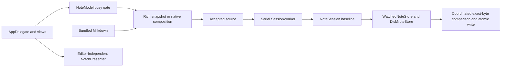

# Codebase audit and agent foundations

Audit baseline: `b87dbc1` (merged Milkdown integration), November 18, 2026.
Follow-up changes live on `stephen.he/codebase-audit`. This is a local engineering
audit, not a security certification, third-party dependency audit, or proof of
all macOS behavior. It does not change the on-disk Markdown format.

## Scope and method

Reviewed authored Swift app/core code, the JavaScript editor/bridge, storage and
watching, geometry/motion/hover, preferences/dialogs, build/package/release
scripts, CI permissions, tests and architectural documentation. Generated web
assets were regenerated and checked for drift rather than manually reviewing
every minified dependency. Branding was checked through existing metadata and
resource tests, not redesigned. No user notes, credentials, production settings
or login registration were inspected or changed by the tests.

| Area | Evidence used | Boundary |
| --- | --- | --- |
| Storage / session | Core/model tests, real coordinated disposable files, red/green Save As regression | Non-cooperating writers can still race coordination |
| Native editor / shell | Existing opt-in native UI suite, plus new blocked-hover-deadline regression | App-local events and synthetic marked text, not a physical IME or global pointer |
| Rich editor | Bundled-JS suite plus new actual WKWebView/native bridge harness | Synthetic paste events and process-delegate simulation, not system clipboard or OS process killing |
| Build / CI | Signed release build, generated-resource reproducibility, offline Python publisher/workflow/wrapper tests | No live publication or hosted execution performed for this audit |
| Resource use | Code-path review and existing bounded-work contracts | No whole-app energy/RSS/latency claim; a size cap is not a memory guarantee |

## Confirmed findings and fixes

| ID | Priority | Before | Fix and regression |
| --- | --- | --- | --- |
| A1 | P2 | Save As compared decoded source with the draft. Foundation consumes a leading UTF-8 BOM: a correctly written BOM draft was rejected, while a raced BOM-only byte change could be accepted | NoteSession.open optionally checks expected raw bytes before adopting state. Real-file/model regression failed in both directions before the fix; session tests verify rejected adoption leaves no open session or writes. Equal serialized bytes remain a clean no-op after adopting a BOM draft |
| A2 | P2 | A hover deadline that fired while pinned/busy/dragging left exitWork non-nil. Later outside movement could not schedule a new deadline | Clear the pending slot when the callback starts, before eligibility checks. Native shell test pins after scheduling, waits for the blocked deadline, then unpins and retries without reentering |
| A3 | P2 | WebKit termination always marked the note dirty and requested recovery, even after rich content had been released or Source mode was active | Only active rich drafts enter recovery. Inactive editors invalidate/recreate the page without publishing dirty state. Real-WebKit harness exercises the delegate boundary after close |
| A4 | P2 | Repeated Restore clicks replaced the one page-readiness continuation. Runtime emitted SWIFT TASK CONTINUATION MISUSE and one task stayed suspended | A generation-aware, single-flight restore request lasts through acknowledgement. Invalidations/errors cancel it; a missing acknowledgement times out and permits retry. Real-WebKit test reproduced the leak before the fix and tests double-click and timeout/retry afterward |
| A5 | P2 | Malformed smoke/benchmark arguments fell through to normal startup, potentially reading real settings and enabling login instead of testing | LaunchMode validates app-owned arguments before NSApplication construction. Pure tests cover malformed inputs and candidate-bundle precedence; recognized test commands fail closed with exit 64 |

No finding above demonstrates an overwrite of an unrelated user file. A1 is a
byte-authority/adoption error, A2 is a retry-state bug, A3 is false recovery/dirty
state, A4 is a real async leak, and A5 is an isolation hazard. Keep those impacts
distinct rather than describing all failures as data loss.

The new GUI wrapper regression tests also prevent missing markers, runtime
continuation warnings, or a nonzero child exit from being reported as success.

## Architecture worth preserving

- File authority remains in the session/store, not JavaScript or a watcher.
  Watcher events invalidate; they never overwrite a visible draft.
- The native committed tree, not a browser dirty hint, authorizes unchanged
  source reuse. Do not weaken serialization checks to make a failing fixture pass.
- A mode switch is not a save. It must preserve unsaved content and the disk
  baseline, including after a failed conversion.
- UI state and continuations stay main-actor-owned; file access remains on the
  serial worker. The two unchecked Sendable classes have specific ownership/
  lock explanations, not blanket exemptions.
- The presenter owns transitions, not notes. Keep animation cancellation and
  frame geometry independent of persistence.
- Production and isolated launches differ explicitly. Never make a harness
  silently fall back to normal startup.

## Smells and follow-up priorities

These are risk-reduction recommendations, not additional confirmed bugs.

| Priority | Smell / location | Why it matters | Recommended next change |
| --- | --- | --- | --- |
| Next lifecycle feature | AppDelegate combines orchestration, platform services and a large in-file acceptance extension | More boolean gates make reentry behavior difficult to reason about; test-only private access pressures the production file to grow | Extract one cohesive boundary at a time when changing it, starting with dialog completion/holds or hover scheduling. Preserve end-to-end shell tests; do not merely split files or invent a general plugin system |
| Next bridge feature | RichMarkdownEditor has a shared deadline and multiple optional continuations/state fields | Restore reentry demonstrated how easy it is to violate request ownership | Keep explicit single-flight/request/generation contracts. Consider a typed pending-request state when adding another asynchronous operation; do not replace the tested bridge wholesale |
| Next dialog change | Not every dialog uses finishNoteDialog for focus and pointer resumption | Cancellation/focus can diverge across Save As, Find, discard and reset | Consolidate completion behavior with focused sheet/cancel tests before changing visible UX |
| Before broader release | Rich text lacks physical IME, VoiceOver, cross-app clipboard and actual process-crash acceptance | Headless tests and synthetic WebKit events cannot establish those system integrations | Run the disposable manual matrix on supported macOS versions; keep failures visible as release gates |
| Before claiming lightweight performance | Full-document canonical JSON is traversed on edits; native source/cache can be large | Linear work and temporary buffers can affect interactive latency despite bounded inputs | Measure app plus WebKit at realistic note sizes; optimize a demonstrated bottleneck, not a hypothetical one |
| When reorganizing tests | Acceptance fixtures compile into the executable; many assertions depend on private controller state | This is pragmatic for the current SwiftPM executable, but grows shipped/test coupling | Consider a shared app module plus a separate acceptance executable when the harness grows substantially. Keep the exact production components and no real-preference access |
| Ongoing | Historical validation sections and fixed test counts become stale | Agents may treat a past pass as current coverage | Date evidence, state the tested revision/scope, and add a current section rather than rewriting historical results |

Do not add a state-machine framework, editor protocol hierarchy, dependency
injection container, or repository-wide formatting churn just to address smells.
Current concrete seams are useful. Every extraction should protect a demonstrated
behavior and make the next change easier to test.

## Testing contract for future agents

| Change | Required evidence |
| --- | --- |
| Pure policy / UTF-16 / geometry | Deterministic Swift unit tests, including boundaries and Unicode where relevant |
| File lifecycle | NoteSession/NoteModel failure and success tests; real coordinated disposable-file tests for filesystem behavior |
| Editor serialization / keys | Tests against the regenerated bundled JS, not a second serializer implementation |
| Native-to-web lifecycle | Rich WebKit harness: actual packaged resources, messages, snapshots, mode changes, conflicts and recovery |
| Hover / focus / native commands | Native GUI harness or a narrowly scoped real-UI regression; unit tests alone cannot establish event routing |
| CI / runner / publication | Offline failure-path tests; never validate using a real release or credentials |

Workflow:

1. Identify the owner and invariant before editing. Read the relevant current
   source, not just this document.
2. Reproduce a suspected bug with synthetic input. Prefer a red test before the
   fix; distinguish source-derived findings from demonstrated behavior.
3. Test success, failure preservation and retry/cancellation at the layer that
   owns them. Avoid asserting internal line counts or mocking away the behavior.
4. Regenerate bundled assets when their source changes and verify no unintended
   generated drift. Keep notices and hash inventory aligned.
5. Run the ordinary suites and whichever opt-in harness the change needs.
   macOS file coordination may need approved host access; never bypass it.
6. Report exact passes and remaining gaps. Native GUI coverage does not count
   as rich GUI coverage; synthetic crash callbacks are not OS crash delivery.
7. Keep fixtures/logs/builds project-local and ignored. Do not use the user's
   selected note, normal settings, system clipboard, login state or external
   telemetry as a test fixture.
8. Review the diff, document changed contracts, and obtain authorization before
   commit/push, installation, or replacing the running app.

See [TESTING.md](TESTING.md) for commands and
[VALIDATION.md](VALIDATION.md) for this audit's final results. The GUI harness is
opt-in, not claimed to run on every hosted CI build.
