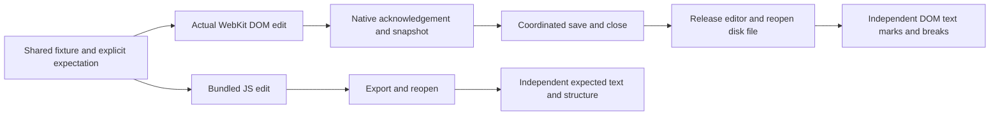

# Markdown parity contracts

Implemented November 19, 2026, after the
[initial parity review](MARKDOWN-PARITY-REVIEW.md). This is a bounded supported
editing contract, not a claim of arbitrary Markdown fidelity.

## Two different tests

| Category | Required result | What passing means |
| --- | --- | --- |
| Named supported edit | Must export, save and reopen with the independently expected semantics | The operation remains usable |
| Named unsupported/unrepresentable edit | Must retain the draft, avoid a file write, explain failure and permit recovery | The integrity guard works |
| Exploratory seeded edit sequence | Either lossless roundtrip or retained guarded draft | Only an integrity property; never evidence that all ordinary edits are usable |

The must-save suite lives in editor.test.mjs and is part of npm test, so the
existing read-only web-editor CI job runs it. A refused snapshot is a test
failure, not an acceptable alternate result. The exploratory test is explicitly
named safety-only and no longer requires that some refusals occur.

## Shared fixture data and independent oracles

`Tests/Fixtures/markdown-parity.json` defines source contexts, text/mark/break
expectations and edit positions. It covers lists, non-1 starts, task state,
nesting, paragraphs, headings, quotes, marks/links/nested marks, tables,
inline/fenced code and soft/hard breaks. Insertions include one/two ASCII spaces,
a tab, NBSP and text containing an emoji.

| Layer | Cases | Oracle |
| --- | ---: | --- |
| Bundled editor under JSDOM | 285 edits across 19 contexts, three positions and five insertions | Test-only observable blocks: exact text code points, mark coverage/link destination/title, breaks, ancestor types and semantic attributes; untouched blocks remain equal |
| Actual WebKit plus native file session | 12 critical shared cases | Independent DOM text/mark/break extraction before editing and after actual file reopen, plus disk/native accepted-source equality |

Neither oracle calls the production exportDifference/layoutProjection helpers.
Syntax-only mark delimiters and visual list labels/spread are not independent
semantic expectations. The production guard still compares the fuller canonical
document strictly under its existing narrow layout allowances; the test oracle
does not replace or broaden that guard.

The inline-code fixture explicitly expects boundary insertions outside the
non-inclusive code mark. That is an editing behavior contract, not a serialization
normalization invented from observed output.

The browser acceptance edits are synthetic text-node changes delivered through
the real ProseMirror DOM-observation path, not physical keys or a second model
serializer. The harness waits for native dirty acknowledgement before saving.
It does not use the system clipboard or user notes.

## Why the additional extension is needed

The earlier standard text-handler correction fixed plain boundary spaces, but
two different upstream transformations still changed rich semantics:

1. The transformer moves leading/trailing whitespace from mark content into
   adjacent unmarked text. For example, a newly typed bold space stops being bold.
2. The preset's soft-break AST transform consumes spaces/tabs before the decoded
   line ending. Encoding a space in Markdown alone cannot prevent this later loss.

Table-cell boundary spaces also need explicit encoding because pipe-table
formatting trims literal padding.

`WebEditor/Milkdown/markdown-whitespace.js` addresses those behaviors through
public text-node and remark plugin extension points:

- A serialization-only `scribbitWhitespace` AST leaf protects boundary whitespace
  from being moved out of marks. Its handler validates that the value contains
  whitespace only and emits numeric character references, never arbitrary markup.
- The ordinary text handler still uses the upstream safety encoder.
- A narrow soft-break transform splits actual line endings without consuming
  decoded spaces/tabs. It operates on parsed AST text, not on raw Markdown using
  a replacement Markdown parser.
- Inline code, fenced code, mark schemas and all remaining Markdown/editor
  features stay upstream-owned.

The extra AST leaf exists only during serialization. It is not a new
ProseMirror node, native bridge type, file format or JSON migration. Numeric
references decode as ordinary text when the file reopens. Initial source
inspection and unchanged-tree source reuse remain in place.

No private library state, runtime monkey-patching, sentinel characters, vendor
edits, unsafe HTML rendering or weaker equivalence checks are used. The new
module is included in the generated asset hash manifest. Dependency upgrades
must verify the public text-schema and remark hook contracts with these fixtures.

## Required maintenance workflow

1. Minimize each unexpected editor failure into a named fixture with explicit
   expected semantics. Classify it as must-save or intentionally unsupported.
2. Assert the intended edit before serialization, then assert it again after
   reopening. Do not use exported Markdown to invent the expectation.
3. For a new supported feature or serializer/parser change, extend combinations
   of formatting, boundary, whitespace, nesting and mode transitions deliberately.
   Promote useful cases into the native critical subset.
4. Keep loss-guard negative tests. Never make a must-save case pass by accepting a
   refused save, trimming user text or globally ignoring mark/attribute differences.
5. Run npm build/test, Swift resource/core tests, and the rich GUI gate from the
   repository root with approved GUI/coordination access. Preserve no-write,
   conflict, discard/retry and source-mode tests.
6. Confirm generated resource reproducibility and required GUI pass markers.
   Record the exact scope and remaining unverified acceptance.

The GUI gate is currently opt-in/local, not silently claimed as hosted CI.
Physical IME, VoiceOver, real cross-app clipboard delivery, OS crash delivery,
multi-version macOS and whole-app resource measurements remain separate gates.
Images/raw HTML/other unsupported constructs still use Source; this change does
not attempt to support arbitrary Markdown structures or promise zero refusals.
