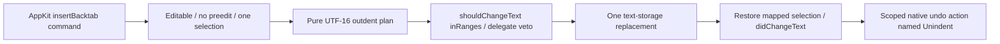

# Native editor and simple Shift-Tab

Current native-editor design, version 0.5.2.

## Decision and scope

Scribbit uses Apple's NSTextView with a small adapter, not a from-scratch text
layout/input engine or a third-party editor fork. macOS 14 is the minimum.

The only custom editing command is `NoteTextView.insertBacktab`. Normal Tab,
composition, selection, clipboard, find and ordinary typing remain AppKit-owned.
The outdent command is a separate non-typing edit transaction, implemented using
public AppKit APIs.

## Behavior

| Input/state | Result |
| --- | --- |
| Tab | Existing AppKit behavior: inserts a literal tab |
| Shift-Tab, caret anywhere in a line | Remove one leading tab or up to four leading ASCII spaces |
| Shift-Tab, selected lines | Apply the same rule to each touched line in one undoable action |
| Selection ends at the following line's start | Do not outdent that following line |
| Internal tabs, unindented line, empty EOF line | No change and no focus navigation |
| Read-only, active preedit, multiple selections | No custom edit |
| Delegate veto | No edit |
| Undo / Redo | Restore/reapply the whole outdent; preceding typing remains a separate action |

Only leading indentation is changed. This is not a shortcut for deleting a tab
in the middle of text. Newline bytes, combining sequences and surrogate pairs
are preserved. The pure planner uses NSString/UTF-16 offsets to match AppKit.

## Implementation



- `Sources/ScribbitCore/TextIndentation.swift` computes one replacement and
  mapped selection; it has no UI, preferences or I/O.
- `Sources/Scribbit/NoteTextView.swift` applies that plan. Native typing
  coalescing is broken at command boundaries. A balanced undo group makes the
  command one action, and the standard change notifications update the model.
- `Sources/Scribbit/EditorView.swift` supplies the plain-source configuration
  and SwiftUI binding. Exact-byte snapshots distinguish external source changes
  from chrome updates. Chrome updates do not overwrite live native preedit.
  External replacement clamps selection and clears undo; editing commands never
  reset the whole editor string.
- `AppDelegate` uses public `unmarkText` before Save/Close so pending composition
  is accepted before persistence. It does not implement or reconstruct an IME.
- Edit menu actions forward to the active editable NSTextView's undo manager.
  Public undo/redo-completion notifications keep the SwiftUI source in sync even
  when native history does not deliver `textDidChange`. Observers are filtered to
  that editor's manager, capture views weakly, and are removed on teardown/deinit.
- Native undo, TextKit, clipboard and input handling are not forked or swizzled.

## Regression tests and the event-boundary finding

Pure tests cover tabs/spaces/mixed indentation, line boundaries, no-ops,
whitespace-only lines, malformed ranges, CRLF/CR/LF/Unicode separators,
combining characters and UTF-16 selection mapping.

The opt-in GUI harness checks an app-local Shift-Tab event, caret and multiline
selection, atomic undo/redo, binding, preceding-typing isolation, read-only and
delegate-veto guards. It also checks composition acceptance/replacement/cancel,
outdent during preedit, chrome changes during preedit and Save/Close persistence.

The initial direct-insertion fixture left an AppKit undo event open at grouping
level one. The next command therefore shared that event, causing Undo to remove
both fixture typing and outdent. A harmless app-local key-up now ends the
synthetic typing event, and the harness asserts grouping level zero before the
next command. Production does **not** inspect grouping levels, close AppKit's
event groups, change groupsByEvent or manufacture keyboard events.

This distinction is important: do not reintroduce event-group manipulation into
the editor to accommodate an inaccurate test driver. The regression still checks
the source, selection and model after Undo/Redo, not merely command dispatch.

The shell test dispatches actual Edit menu actions and verifies Undo/Redo of
committed caret composition in both source and model. This is not proof of every
selected-source history or physical input-method workflow. Physical candidate
UI, dead keys, dictation, keyboard-layout variants, accessibility and real notch
interaction still need manual acceptance.

See `VALIDATION.md` for current commands, results and acceptance limits.
Component benchmark output does not establish whole-app resource costs.

## Build and run tests without changing the current app

```sh
Scripts/test.sh
Scripts/build-app.sh
Scripts/gui-smoke.sh native "$PWD/build/smoke"
```

GUI launch and actual filesystem coordination may require approved host access.
Tests use project-local disposable files and do not change production preferences,
login registration, the general clipboard or the selected user note.

The build script assembles a fresh signed bundle without retired notices.
An existing destination bundle is preserved in the package staging directory.
Building does not quit, launch, install or change login registration.
