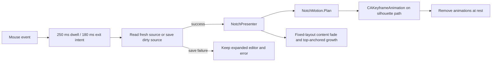

# Notch-attached UX and motion

Scribbit presents a black, screen-attached note surface below the camera housing.
It uses public AppKit screen geometry and Core Animation to animate a silhouette
inside a fixed-size window. See [Apple platform API references](REFERENCE.md).

## Motion and interaction settings

The motion parameters below describe **1× speed**. A persisted 0.5×–2× playback
rate scales all shape/content/completion durations together, not the sampled
spring geometry. Hover deadlines and the fixed Reduce Motion fade do not scale.
Changing the rate during motion only affects subsequent transitions.

| Aspect | Implementation |
| --- | --- |
| Resting left wing | Optional 36-point pencil wing; one contour connects it to the cutout, with an offset-aware morph into/out of the editor |
| Controls | Top header removed; file/actions/status/speed are in a bottom disclosure, collapsed each open. Only a 20-point chevron remains; errors stay visible |
| Attached surface | Black silhouette reaches the screen's top edge, concave shoulders and rounded bottom corners; content stays below the physical camera |
| Width expansion | Perceptual duration 0.44 s, bounce 0.25 |
| Height expansion | Perceptual duration 0.38 s, bounce 0.22 |
| Width / height collapse | 0.30 / 0.26 s, critically damped, no overshoot |
| Overshoot | At most 12 points, included in a fixed window reservation |
| Content arrival | 0.45 s fade, opacity held at zero for first 35%; scale 0.86 to 1 about content top-center, cubic timing control points 0.22, 1, 0.36, 1 |
| Departure | Outgoing source remains visible, fading for 0.16 s while the shape contracts; text is released only after dismissal completes |
| Shape geometry | Shoulder capped at 14 pt, lower radius capped at 28 pt; native circular arcs |
| Hover entry / exit | 250 ms dwell / 180 ms exit delay; reentry cancels dismissal |
| Focus | Menu and completed hover openings activate the panel and focus the editor at the restored selection; type without clicking |
| Pin | Keeps the note open across pointer exit, outside clicks, and app deactivation; Done/Escape/normal quit still save and close |
| Working-surface holds | Menus, dialogs, file I/O, and active pointer drags inhibit hover dismissal |
| Accessibility | Reduce Motion uses a 140 ms fade, without the size spring or content growth |
| Blur | No arrival blur or private filter discovery |
| Scope | No haptics, glass, floating companion controls, mission-control detection, content switching, or dynamic-size motion retargeting |

The *perceptual durations* above are oscillator parameters, not hard animation
cutoffs. `NotchMotion.Plan` samples at 120 Hz through settling within 0.5 point,
then supplies an exact final target. Onscreen animation runs in Core Animation;
there is no per-frame SwiftUI layout, window resize, polling timer, or display link.

These are Scribbit's configured motion values, not a claim that Apple publishes
this exact profile or a ready-made notch presentation component.

## Responsibilities

- `AnimationSpeed` normalizes untrusted persisted rates and scales durations. `AppSettings`
  persists the speed; the presenter snapshots it at transition start.
- `NotchGeometry.panelFrame` is a top-attached reservation, including spring
  overshoot. The hosting view is laid out once inside that reservation.
- `NotchContour` generates the shared shape for animation, hit-testing, screenshots,
  and the fixture-only animated preview. Transparent corners are not interaction targets.
- `NotchPresenter` owns Core Animation and transition completion. Display changes
  settle old transitions and invalidate stale callbacks. Close during expansion
  waits for arrival, saves, then dismisses. It never hides after a failed save.
  Since 0.5.1 it accepts a standard NSPanel and arbitrary content. One cancellable
  task replaces the callback/continuation-waiter bookkeeping. Phase and visibility
  have one completion owner; superseded callers cannot alter replacement motion.
  This is a lifecycle refactor, not a change to the motion parameters above.
- `NoteModel.close(keepPresentation: true)` preserves outgoing UI text after the
  worker has saved. `clearClosedPresentation` releases it after the collapse. The outgoing editor is
  noneditable, and its keyboard focus is resigned before save, so late keystrokes
  cannot enter an already-saved buffer during departure.
- `AppDelegate` distinguishes hover openings from explicit menu openings for
  pointer-exit dismissal, not keyboard focus: both focus the editor.
  A pending hover rechecks pointer eligibility after disk read to avoid a late
  flash or activation after the pointer has left.
- Production pointer reads always come from NSEvent. The isolated GUI harness can
  inject coordinates without warping the real cursor or posting global events.

## Evidence and preview

`build/smoke/motion-preview.gif` is a **rendered fixture preview**, generated
from the same oscillator and content timing parameters. It is not a recording of
the user's desktop or proof of physical notch event delivery.
No screen-recording permission is needed to generate it.

Automated tests cover timing, bounded overshoot, monotone collapse, fixed top
edge, reserved bounds, top-edge hit testing, working-surface holds, and retaining
outgoing text. The opt-in native harness additionally inspects the installed CA
animations, invariant window frame and arrival anchor, Reduce Motion, display
changes, close-during-opening, controller dwell/exit, reentry cancellation, pin,
and a failed save during hover dismissal. Hardware event delivery and subjective
animation quality still require manual checks.

## Version 0.3 native checks

The new harness verifies that expanding/collapsing bottom controls retains the
same NSTextView, selection, undo stack, and source bytes, and returns the viewport
to its full collapsed height. It checks actual CA durations at 2× and 0.5×,
in-flight speed stability, and Reduce Motion's independent fade. It also compares
the first/last animation paths against the left resting wing's exact global frame.
The slider/menu preference is tested with RAM-only settings; no production defaults
or login registration is changed by testing.
