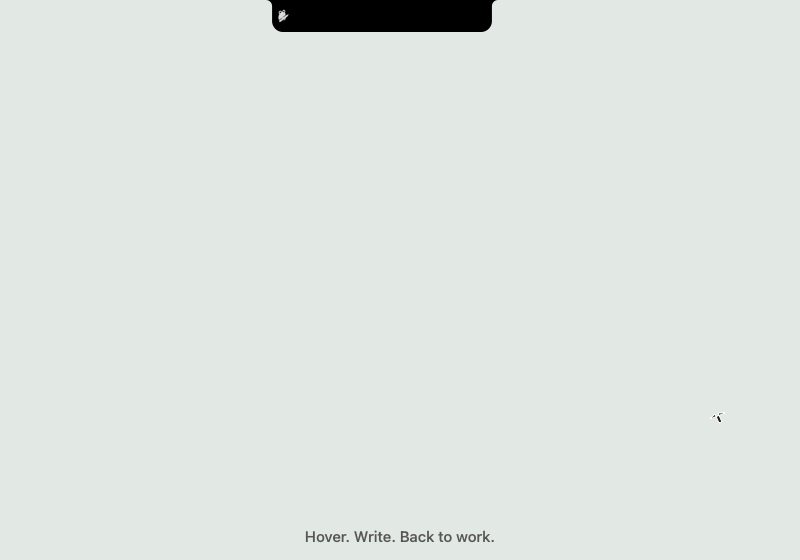

# Scribbit

Scribbit includes [Milkdown rich Markdown editing](Docs/MILKDOWN-EDITOR.md), with
an editable source mode and native fallback for unsupported or larger notes.

A lightweight macOS notepad tucked into your notch. Hover to capture a thought,
then get back to work. Plain-text files, rich Markdown, and no cloud required.



*Rendered workflow preview using Scribbit's geometry, motion profile, and frog
artwork, with the optional resting-notch indicator enabled and open-footer
branding. Sample text and pointer are illustrative.
[View the still image](Docs/Images/scribbit-demo.png).*

**Status:** Development builds / build from source (version 0.5.2). No notarized download or universal
binary is available yet. Supported Markdown and untitled notes use bundled Milkdown/Crepe in an offline
WKWebView. Native NSTextView handles source editing and fallback. Dependencies
are pinned with complete license notices; see the editor documentation.

A small native macOS app for one file-backed note, expanding directly
from the notch with a spring-animated black silhouette. Move the pointer to
the notch for 100 ms by default, start typing, and press **Escape** to save and hide it.
On displays without a notch, use the top-center 120-point strip.

**Requirements:** macOS 14 or later; Swift 6 / modern Xcode Command Line Tools to
build. Rich editing bundles Milkdown in WKWebView; no network service or account is required.
The app and supplied CLT test-framework fallback require macOS 14. Builds target the current architecture.

## Development downloads

[**Download the latest development build**](https://github.com/yihehe/scribbit/releases/download/development/Scribbit-macOS.zip)

This link becomes available after the first successful `main` publication with
the development-build workflow. One mutable **Development build** prerelease
keeps the latest successful ZIP until it is replaced or deleted. Release notes
identify its source commit, build, checksum and architecture.

Each successful CI build also saves a commit/run-named **Actions artifact** using
the repository's default retention. For older or branch/PR builds, open
**Actions → Build and test → successful run → Artifacts** while signed in.
Extract the artifact, then its `Scribbit-macOS.zip`, to obtain `Scribbit.app`.

These are **ad-hoc-signed, unnotarized development builds**, not trusted public
releases. macOS may block a downloaded app. They target the runner's architecture,
not a universal binary; check the release notes before downloading. Developer ID
signing, notarization and cross-machine acceptance are not provided by this CI.
See [development-build management](Docs/DEVELOPMENT-BUILDS.md) for retention,
permissions, prerequisites and recovery.

## Build and use from source

```sh
git clone https://github.com/yihehe/scribbit.git
cd scribbit
Scripts/test.sh
Scripts/build-app.sh
```

The result is `build/Scribbit.app`. Move it to `/Applications` (or
`~/Applications`), then open it in Finder. **Run the app bundle, not the raw Swift
executable:** Launch at Login needs a stable installed bundle path and signature.
The build script uses an ad-hoc signature for local use. For distribution, set
`SIGNING_IDENTITY` to a Developer ID identity, notarize, and staple yourself;
notarization and universal distribution are not included.

With no selected file, Scribbit opens the regular editable notepad with **Open…**
and **Save As…**. The untitled draft stays in memory when dismissed and reopened;
a visible warning explains that it is not saved. Opening another file or quitting
normally asks **Save As / Cancel / Discard** if the draft contains text. Save As
creates a new file and never overwrites an unopened existing file.
Expand the bottom chevron for the settings gear, or press **Cmd-,** directly.
There is no persistent menu-bar icon. Hover to reopen the
surface, or reopen Scribbit from Finder/Spotlight while it is running.
The selection must be a regular UTF-8 text/Markdown file no
larger than **64 MiB**. Extensions are not enforced. RTF, Word, PDF, and non-UTF-8
encodings are deliberately unsupported. Selecting a symlink edits its resolved
target, not the symlink itself. Create does not truncate an existing file.

| Interaction | Result |
| --- | --- |
| Hover over notch/top-center strip for the configured delay | Validated note snapshot, then editor opens below the camera; default 100 ms |
| Reopen Scribbit from Finder / Spotlight | Opens the working surface without requiring a menu-bar icon |
| Choose Note File… / Cmd-O | Saves the current note first, then selects another file |
| Done / Cmd-Return / Escape / Cmd-W | Saves dirty content, then hides |
| Click outside / switch apps | Saves and hides, unless a dialog or save is already in progress |
| Normal Quit / system termination request | Attempts save; refuses termination if saving fails |
| System sleep notification | Best-effort save; OS may suspend before it completes |
| Cmd-S | Saves without hiding |
| Tab / Shift-Tab | Tab inserts a literal tab. Shift-Tab removes one leading tab or up to four leading spaces from current/selected lines, with atomic undo/redo |
| Cmd-F, Cmd-Z, Cmd-Shift-Z, clipboard shortcuts | Editor find, undo, redo, cut/copy/paste |
| Expanded-section gear / Cmd-, | Open a transient settings popup. Cmd-, also works collapsed, anchored to the visible chevron, and with no file open |
| Expanded section → Pin note open | Keep the working surface open across pointer exit/outside click/app switching |
| Bottom chevron | Expand/collapse file information/full path, pin/editor mode, and settings gear; collapsed on each open |
| Settings → Animation speed | Persisted 0.5×–2× playback rate in 0.25× steps; 1× keeps the reference motion profile |
| Settings → Hover to open | Persisted 0–1000 ms entry delay in 50 ms steps; default 100 ms |
| Expanded section → Editor mode | Switch between editable rich Markdown and source; conversion failure keeps the current draft |
| Settings → Launch at Login | Enables/disables macOS Service Management registration |
| Settings → Show frog beside notch | Optional frog-and-pencil mark inside a black extension connected to the camera; off by default |

The open note keeps a small frog-and-pencil **Scribbit** mark at bottom-left,
including when the information section is collapsed. It shares the existing
footer row with the centered chevron, with a little breathing room above; it is
branding, not another button.
The optional closed-notch frog remains a separate setting.

A hover-opened note collapses 180 ms after the pointer leaves; moving back cancels
that dismissal. Expand the chevron and enable **Pin note open** to keep it open while writing. An explicitly opened
note does not close merely because the pointer is elsewhere. Both hover and
explicit openings focus the editor, so typing resumes at the restored position
without a click. A completed hover dwell therefore moves keyboard focus from
your current app into Scribbit.

Each reopening restores the current file's last caret or selection. If the file's
contents are unchanged, the editor also restores the last scroll position—even
if you scrolled away from the cursor to read. If contents changed externally, the
saved scroll position is discarded and the safely clamped cursor is shown instead.
Positions are kept only for the last file during this app run, not across quitting
or switching files. Fresh disk contents remain authoritative. This is position
restoration, not tracking a word as other editors insert text.

The top header is gone. File information, a selectable full path, pin/editor-mode
icon buttons, and the settings gear live in a bottom disclosure that starts closed.
Filled/tinted button state shows the active editing modes; their accessible
names, On/Off state, and help text remain available.
Long paths use two lines/middle truncation and expose the complete path as help
and accessible text. The collapsed footer keeps the frog/Scribbit mark and
centered chevron visible. File actions,
login, indicator, animation speed, hover delay, About, and Quit live in the native transient popup.
Opening it inhibits automatic note dismissal while interacting with settings.
Escape first dismisses settings, then a second Escape saves and closes the note.
About contains the app icon, name, version, Close, and the deliberately tucked-away
Reset App action for first-time-setup testing. Its native
sheet stays above the notch surface and below its camera-safe top boundary,
rather than using an unparented app-modal window behind it.
Save errors and recovery actions are never hidden by that disclosure. After explicitly closing over the notch, leave
the trigger region before reentering to reopen. The pinned surface also ignores
outside clicks/app deactivation, but Escape, the settings Done action and normal quit still save/close.

## Animation and resting wing

Use **Animation speed** in the settings popup.
0.5× is half-speed, 2× is double-speed. Shape, content growth/fade, and completion
use one playback rate without changing the spring's bounce or overshoot. A change
during animation applies to the next transition. Hover delay is independent:
use **Hover to open** in the settings popup to choose 0–1000 ms, in 50 ms
steps. The default is 100 ms. Choose 0 ms to remove the entry wait; file loading
and the opening animation still take their normal time. The setting affects only
time spent over the trigger before opening, not the animation or the fixed
180 ms exit delay. Changing a pending dwell cancels it and starts a fresh full
delay if the pointer remains eligible;
it never bypasses the leave-and-reenter requirement after explicitly closing.
Reduce Motion retains its fixed 140 ms fade and no spring/growth.

The pencil's left wing shares one continuous contour with the camera cutout;
opening/collapse interpolate its left-shifted center as well as its size. It is
not a separate icon beside the notch. See `Docs/INDICATOR.md` for geometry/limits.

## Launch at login

First launch requests registration using `SMAppService.mainApp`. macOS may require
approval in **System Settings → General → Login Items**. The settings popup refreshes registration
state each time it opens; selecting a pending-approval item opens System Settings.
Later user changes in System Settings are not automatically undone on launch.
If registration fails, use the popup to retry after installing the bundle.

To test first-time setup, use **Settings → About → Reset App…**. Reset requires
confirmation, resolves unsaved text first, forgets the selected file and app
settings, and immediately opens a blank notepad without deleting note files. It
also disables login registration now; like a fresh first launch, the next launch
attempts registration again. No restart is required to use the blank notepad.

Registration is implemented, but only an actual approved login cycle on your Mac
can validate automatic startup. Rebuilding/replacing an ad-hoc-signed app may
invalidate macOS login approval. Use a stable signing identity for everyday use.
To uninstall, disable Launch at Login first, quit, and delete the app.

## Saving and recovery

- Untitled drafts are RAM-only and survive ordinary dismissal, but not process
  exit, Force Quit or a crash. **Cmd-S** opens Save As; normal quit asks before
  discarding nonempty text.
- Reopening uses one bounded RAM snapshot when file/parent observation and
  identity, size and timestamp checks permit it; otherwise it reads from disk.
  Native change notifications invalidate the snapshot without polling or silently
  reloading a visible editor. Explicit Reload always reads from disk. Event
  delivery is asynchronous, so this is not an instantaneous freshness guarantee.
  A failed read never replaces the selected file with empty text; recovery can
  show a separate, clearly labeled untitled draft with the error.
- Dirty content is compared with the exact bytes read at open/last save, inside
  `NSFileCoordinator`, then written atomically. Read and write transactions use
  a dedicated serial worker, not the UI thread. Controls freeze during I/O.
- If another editor changes/deletes the file, **your buffer stays open** with a
  visible error. Use **Save a Copy…** to preserve your version, or **Reload from
  Disk…** to explicitly discard it after confirmation. A clean close never writes.
- Save a Copy exports the current buffer; it does not switch files, resolve the
  original conflict, or hide the editor. A failed reload preserves your edits.
- One selected-note snapshot may remain in RAM while hidden, bounded by the
  64 MiB source limit. This is not a total memory budget or a responsiveness
  guarantee: native editor layout, undo and preview can use substantially more.
  Selected-file access stays active for watching until file switch or quit.
- There is **no autosave journal or hidden note database**. Force Quit, a crash,
  power loss, and forced shutdown can lose unsaved edits. Use Cmd-S for long edits.
- Coordination protects against participating macOS apps, not all possible
  external writers. A non-cooperating process can still write in the final
  compare/replace window. Cloud conflicts and remote-file availability are not
  solved. Prefer a local file; keep normal backups for valuable notes.
- Atomic replacement changes the file inode; hard links are not kept in sync.
  Extended attributes/ACLs and file-provider-specific semantics are not guaranteed.

## Markdown and resources

Markdown stays the on-disk format. Supported `.md` and untitled notes open in
Milkdown rich editing; `.txt`, unsupported Markdown (including images/raw HTML)
and files beyond the 1 MiB initial rich-admission bound stay editable in native Source.
Use the expanded-footer **Editor mode** button to switch between editable Rich
and Source. Switching converts the current unsaved draft only after validation;
it does not save or reset the file's conflict baseline. Failed conversion retains
the current editable draft and explains why. No JSON note migration occurs. Already-loaded rich drafts may grow beyond 1 MiB
and still save/switch to Source, up to the normal file limit; a 2 MiB canonical
rich-document quota rejects oversized edits before inserting them.

Lists, tasks, code fences/highlighting, headings, tables and ordinary links are
supported. Images and image paste/drop are not yet enabled. Clean close/save and
Undo-to-baseline preserve original Markdown bytes, including BOM/CRLF; actual
rich edits can normalize Markdown spelling/layout after semantic checks. Keep
backups for valuable notes. See [editor behavior and limits](Docs/MILKDOWN-EDITOR.md).

Idle work is event-driven: no app-owned recurring polling/network timers or
Markdown parsing while hidden. Native file/parent observations invalidate the
selected-note RAM snapshot without background rereads. Finite work handles hover,
transitions and visible-editor RAM checkpoints. Core Animation morphs a fixed
window mask, avoiding per-frame editor relayout. The shell and source editor are
native AppKit/SwiftUI; rich content uses a warm nonpersistent WebKit process with
bundled offline assets, denied network/external navigation and no remote images.
Whole-app plus WebKit startup, idle and memory costs are not measured yet; do not
interpret component tests or the [file-watching benchmark](Docs/FILE-WATCHING-PERFORMANCE.md)
as proof of lightweight whole-app performance.

## Privacy

The app has no analytics, telemetry, cloud service, or automatic uploads.
Development outputs and test fixtures stay inside the project directory.
At runtime the installed app stores **only a file-location
bookmark, login-offer flag, indicator preference, animation speed, and hover delay** in macOS UserDefaults
under `com.stephenhe.Scribbit`; note contents live in the selected file and RAM,
plus any explicit Save a Copy destination. macOS also owns login registration.
No Accessibility, Input Monitoring, or Screen Recording permission is requested:
global monitors observe **mouse events only**; keyboard events are local to the app.
Protected folders may require normal macOS Files and Folders access.

This app identity starts with its own preferences. When switching from a
differently identified development build, choose your note again and explicitly
configure launch at login. Existing note files and other apps' settings are not
migrated, deleted or rewritten. Quit any other build before opening this one.

## Project guide

- [README demo source and reproduction](Docs/README-DEMO.md)
- [Frog branding and editable SVG sources](Docs/BRANDING.md)
- [Native editor and Shift-Tab design](Docs/NATIVE-EDITOR.md)
- [Notch UX, matching profile, and animation limitations](Docs/NOTCH-UX.md)
- [Architecture and invariants](Docs/ARCHITECTURE.md)
- [Testing and acceptance checklist](Docs/TESTING.md)
- [Validation results](Docs/VALIDATION.md)
- [P2 indicator ideas](Docs/INDICATOR.md)
- [Apple platform API references](Docs/REFERENCE.md)
- [Next-agent instructions](AGENTS.md)
- [Contributing](CONTRIBUTING.md)

The build scripts include a **project-local** workaround for a CLT installation
where PackageDescription's private interface is older than its public interface
and dylib. No SDK or global toolchain file is edited. A normal Xcode installation
does not need this path. `Scripts/test.sh` also locates CLT's bundled Swift Testing
framework when SwiftPM does not add its framework search path automatically.

## License

Scribbit is licensed under the [MIT License](LICENSE).
